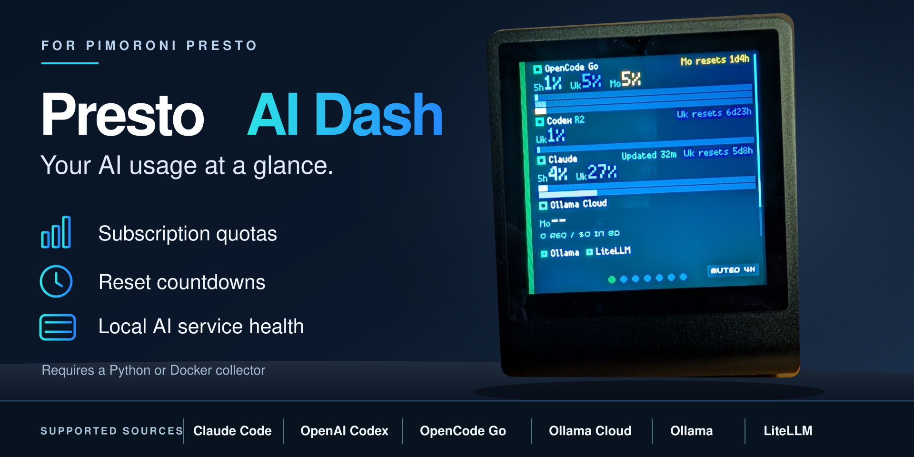
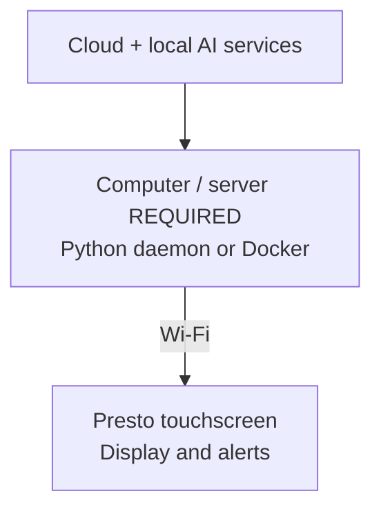

# Presto AI Dash

**Always in view. Never in your way.**

Monitor AI usage, subscription limits, reset times, and service health across your accounts—all at a glance on a dedicated display.

**No windows. No screen clutter. Just the information you need.**

[**Website**](https://jake1164.github.io/presto-ai-dash/) · [**Live Demo**](https://jake1164.github.io/presto-ai-dash/demo/) · [**Documentation**](https://jake1164.github.io/presto-ai-dash/docs/) · [**Get Started**](https://jake1164.github.io/presto-ai-dash/docs/getting-started/install-the-daemon/) · [**Request a Source**](https://github.com/jake1164/presto-ai-dash/issues/new/choose) · [**♥ Support**](#support-development)

  

Try it in your browser, no Presto needed: [see it running](https://jake1164.github.io/presto-ai-dash/demo/).

## Your AI usage at a glance

Presto AI Dash turns a **Pimoroni Presto touchscreen** into a dedicated monitor for AI subscription quotas, reset countdowns, and local AI services. Swipe between service cards, see warnings at a glance, and know when a reading is stale or unavailable.

Provider collection is **read-only**: the app never sends prompts, spends credits, or changes plans or limits. API keys are encrypted in the daemon's database; the Presto never holds a provider key.

> [!IMPORTANT]
> **A separate computer or server is required.** This is **not a standalone app that runs entirely on the Presto**. You must run the **Python daemon as a background process or Docker container** on a computer/server on your network. It collects the data and keeps provider credentials; the Presto connects over Wi-Fi to display readings and control its own alerts.

## Supported services 

<table>
  <tr>
    <td width="400"><a href="https://jake1164.github.io/presto-ai-dash/docs/guides/claude/"><strong>Claude Code ↗</strong></a> Subscription quota &amp; activity</td>
    <td width="400"><a href="https://jake1164.github.io/presto-ai-dash/docs/guides/codex/"><strong>OpenAI Codex ↗</strong></a> Quotas, resets &amp; banked credits</td>
  </tr>
  <tr>
    <td><a href="https://jake1164.github.io/presto-ai-dash/docs/guides/opencode-go/"><strong>OpenCode Go ↗</strong></a> Subscription limits &amp; resets</td>
    <td><a href="https://jake1164.github.io/presto-ai-dash/docs/guides/ollama-cloud/"><strong>Ollama Cloud ↗</strong></a> Credit balance, quota &amp; rolling activity</td>
  </tr>
  <tr>
    <td><a href="https://jake1164.github.io/presto-ai-dash/docs/guides/ollama/"><strong>Ollama ↗</strong></a> Local models &amp; server health</td>
    <td><a href="https://jake1164.github.io/presto-ai-dash/docs/guides/litellm/"><strong>LiteLLM ↗</strong></a> Gateway usage, health &amp; spend</td>
  </tr>
</table>

Each service links to its metrics, setup, collection method, and limitations. Also see [Source concepts](https://jake1164.github.io/presto-ai-dash/docs/concepts/sources/) and [where quota numbers come from](https://jake1164.github.io/presto-ai-dash/docs/concepts/quotas-and-provenance/).

### 🔌 Missing your favorite AI service?

Presto AI Dash is designed to grow. Request a new provider, subscription, or local service—**no coding or API knowledge required, and requests are free.**

[**💡 Request a Source →**](https://github.com/jake1164/presto-ai-dash/issues/new/choose) &nbsp;&nbsp; [**🔧 Contribute a Source →**](CONTRIBUTING.md)

## Get started

1. [Install the daemon](https://jake1164.github.io/presto-ai-dash/docs/getting-started/install-the-daemon/) or [run it with Docker](https://jake1164.github.io/presto-ai-dash/docs/getting-started/install-with-docker/) **on your computer or server**.
2. [Add your first source](https://jake1164.github.io/presto-ai-dash/docs/getting-started/add-the-first-source/), or enable **Demo mode** on the admin page's **Settings** tab. It shows six sample accounts, marks them with a DEMO chip, and writes nothing.
3. [Set up the Presto](https://jake1164.github.io/presto-ai-dash/docs/getting-started/set-up-the-presto/) to connect over Wi-Fi.

For Claude and Codex with a Docker daemon, run a [remote collector](https://jake1164.github.io/presto-ai-dash/docs/guides/remote-collectors/) on the computer where you use them.

For configuration, troubleshooting, security, and detailed limitations, see the [documentation](https://jake1164.github.io/presto-ai-dash/docs/) and [privacy notes](https://jake1164.github.io/presto-ai-dash/docs/privacy/). The app itself sends nothing anywhere; only the documentation website counts page views, with Google Analytics, as the privacy notes explain.

## Support development

If Presto AI Dash is useful, a **GitHub star** helps others discover it. Sponsorships and coffee donations help support maintenance, testing, and future integrations. Donations are optional and don't guarantee a particular integration.

  
  

## More projects

**Pimoroni and maker projects:** [Presto Snake](https://github.com/jake1164/presto-snake) · [Awesome Pimoroni Presto](https://github.com/jake1164/awesome-Pimoroni-Presto) · [Waveshare Weather Clock](https://github.com/jake1164/Pico-RGB-Matrix-Weather-Clock) · [Tempest Weather Clock](https://github.com/jake1164/tempest-led-weather-clock)

**Self-hosted software:** [Family Librarian](https://github.com/jake1164/family-librarian) · [M3Undle](https://github.com/Sydney-Elvis/M3Undle)

Developers: [contribution guide](CONTRIBUTING.md) · [running the tests](https://jake1164.github.io/presto-ai-dash/docs/developers/running-the-tests/) · [developer notes](docs/README.md) · [changelog](CHANGELOG.md).

MIT licensed. See [LICENSE](LICENSE) and [third-party notices](THIRD_PARTY_NOTICES.md).
