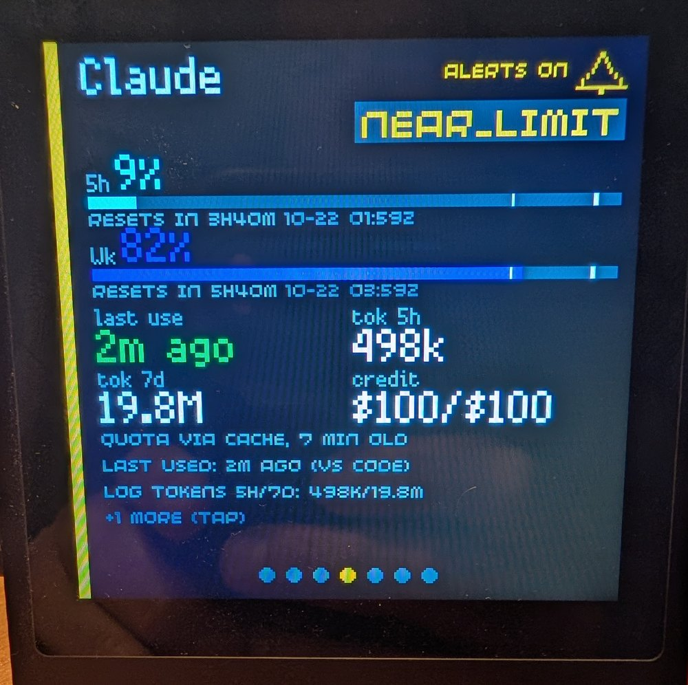
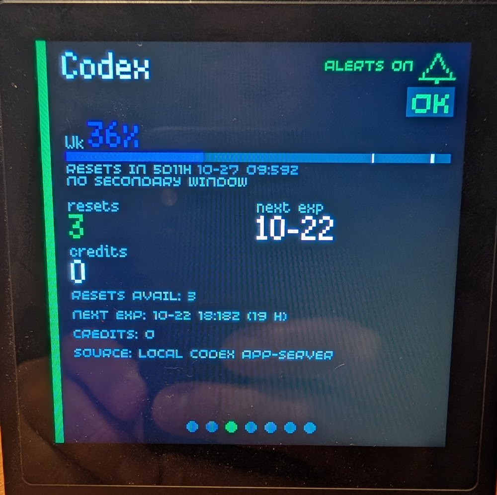
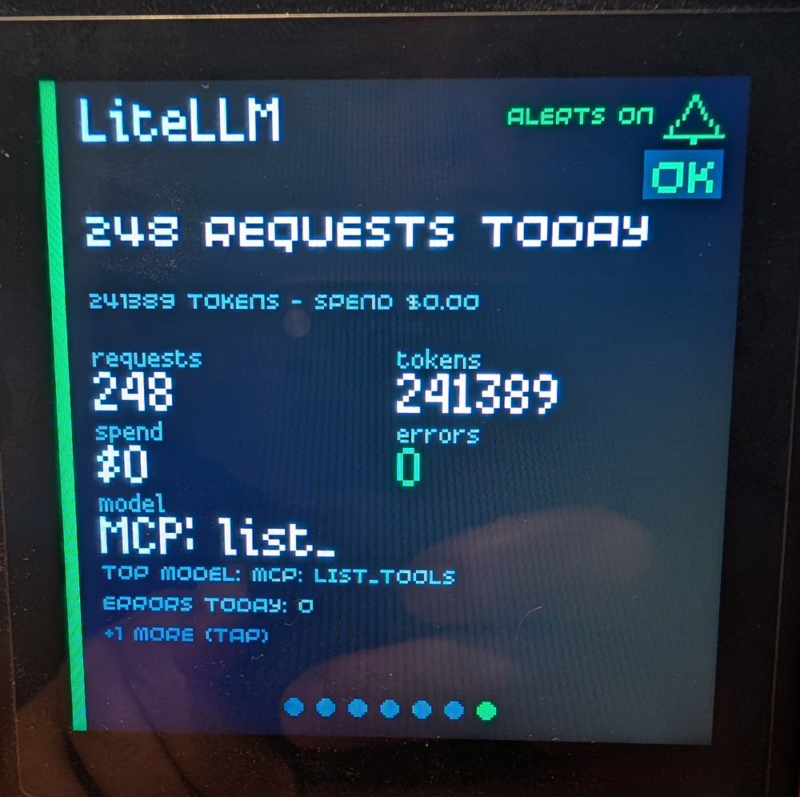

# Presto AI Dash

A tiny AI usage dashboard for Pimoroni Presto with support for local and cloud AI providers.

<p align="center">
  
</p>

<p align="center">
  
  
  
</p>

Documentation: <https://jake1164.github.io/presto-ai-dash/>

Presto AI Dash puts your AI subscription quotas and the health of your local
AI services on a 240x240 touchscreen on your desk. A small Python daemon on
your LAN reads the numbers, read-only, and the Presto polls it and draws them.

## What it shows

- **Quota windows** for each subscription account (`5h`, `Weekly`, `Monthly`,
  as the provider reports them), each with its percentage, a bar, the time
  to its reset, and tick marks at the warning and critical thresholds.
- **Local service health**: whether Ollama is up and which model is loaded,
  whether the LiteLLM gateway is healthy, and today's requests, tokens,
  spend and errors.
- **A Home list** of every service in the order you set in the admin page,
  and **a card per service** with its quota windows, tiles (for example
  last use, tokens, spend, top model) and detail lines.
- **Alerts**: a service that crosses its warning or critical threshold turns
  yellow or red, the LED shows the worst service, and Home can scroll to the
  alarmed service. **Sound is optional and off by default.** A long press
  mutes, and the **mute expires** (four hours by default) with a chip that
  says how long is left.
- **Touch**: swipe between cards, drag to scroll Home, **tap a row or a page
  dot** to jump to that card, and tap **the bell on a card** to switch that
  one service's alerts on or off.
- **Honest staleness**: an old reading is dimmed and labelled with its age,
  an expired window shows `--`, and a missing reading is never shown as `0%`.

## What it reads

| Source | What it reads | Where it runs |
| --- | --- | --- |
| Claude | The Claude Code **status-line export** (5-hour and weekly quota, after a terminal response); optionally the **local activity logs** (timestamps, model and token counts only) and the **usage cache** Claude Code keeps for its `/usage` dialog | On the machine where Claude Code runs; the status-line export can also be pushed from another computer |
| Codex | Quota buckets, resets and banked reset credits through the local **Codex app-server**, using your existing Codex login | On the machine with Codex and its login |
| OpenCode Go | 5-hour, weekly and monthly quota and resets from its usage API, with your API key | Anywhere with internet access |
| Ollama Cloud | Dated request, token and spend activity from its usage API (no allowance is reported) | Anywhere with internet access |
| Ollama | Server health, version, installed and loaded models | Anywhere that can reach the Ollama server |
| LiteLLM | Health, readiness, and today's requests, tokens, spend and errors | Anywhere that can reach the gateway |

A `fake` source cycles through every status for demos and hardware checks.
API keys are stored encrypted in the daemon's SQLite database; the Presto
never holds a provider key. Details per source:
[Guides](https://jake1164.github.io/presto-ai-dash/guides/claude/).

## Request or contribute a source

Missing an AI service? [Request a source](https://github.com/jake1164/presto-ai-dash/issues/new/choose)
with its name, official link, and the measurements you'd like to see. You
don't need to know its API or write code.

Want to build an integration?
[Contribute a source](CONTRIBUTING.md) using the existing
[source template](daemon/templates/source_template.py) and
[developer guide](https://jake1164.github.io/presto-ai-dash/developers/contributing-sources/).
You can submit a pull request directly; an issue is optional.

## How it fits together

```text
  Claude Code, Codex, OpenCode Go, Ollama Cloud, Ollama, LiteLLM
                |  read-only
                v
  +-------------------------------+      admin page (browser, port 8788):
  |  daemon (Python 3.11+, LAN)   | <--  accounts, keys, alert settings
  |  collect -> SQLite -> serve   |
  +-------------------------------+
                ^  GET /api/v1/status every ~15 s (shared token)
                |  POST /api/v1/alerts/<id> (one service's alerts on/off)
  +-------------------------------+
  |  Pimoroni Presto (MicroPython)|  touchscreen, LEDs, buzzer
  +-------------------------------+
```

More: [Architecture overview](https://jake1164.github.io/presto-ai-dash/developers/architecture/).

## Quick start

1. [Install the daemon](https://jake1164.github.io/presto-ai-dash/getting-started/install-the-daemon/)
   (or [install with Docker](https://jake1164.github.io/presto-ai-dash/getting-started/install-with-docker/)).
2. [Add the first source](https://jake1164.github.io/presto-ai-dash/getting-started/add-the-first-source/)
   in the admin page.
3. [Set up the Presto](https://jake1164.github.io/presto-ai-dash/getting-started/set-up-the-presto/).

## Privacy

The app only **reads** from providers. It never spends or redeems credits,
never resets a quota, never changes a plan or a limit, and never sends a
prompt or a model request to produce a number. It sends nothing about you
anywhere. The one write the Presto can make is to switch one service's
alerts on or off **on its own daemon**; no provider is contacted. Setup
actions that touch an account (for example installing the Claude status-line
export) run only when you press the button in the admin page. See
[Privacy](https://jake1164.github.io/presto-ai-dash/privacy/).

## Limits

- **Containers:** the Claude activity and usage-cache readers and the Codex
  source read files and logins on the daemon's own machine, so inside a
  container they get nothing by themselves. A collector on the machine that
  has them (its `watch` mode, plus the status line for Claude in a terminal)
  pushes what they would read. It has been tested against a throwaway daemon,
  not yet on a second real computer.
- **Claude in the VS Code panel** does not run the status line; panel users
  get quota from the usage cache reader instead, which reads an unofficial
  file. See [The VS Code panel](https://jake1164.github.io/presto-ai-dash/troubleshooting/vs-code-panel/).
- **Ollama Cloud** reports activity only, no allowance or balance, so it has
  no quota bar. **Ollama** has no request history, so direct use cannot be
  counted.
- **The host preview** runs the real app against an emulated display, but it
  cannot show sound, real LED hardware, memory or CPU limits, or Wi-Fi.

## Running the tests

```bash
cd daemon
../.venv/Scripts/python -m unittest discover -s tests -q    # .venv/bin/python off Windows
```

The suite is pure CPython with localhost HTTP only; the Presto logic is
tested on the host too. Tests are grouped into `core`, `admin`, `providers`,
`ingest`, `device`, `security` and `tooling` folders. VS Code offers **Run test
group** and **Run all tests** tasks. See
[Running the tests](https://jake1164.github.io/presto-ai-dash/developers/running-the-tests/)
and, for the screen preview and the device sync,
[The preview and the device sync](https://jake1164.github.io/presto-ai-dash/developers/preview-and-device/).
Repository-internal notes (status, contracts, history) are indexed in
[docs/README.md](docs/README.md).

## Licence

MIT. See [LICENSE](LICENSE) for the full text and the copyright notice.

No provider logos, mascots or artwork are shipped in this repository. The
host-side preview tools carry bitmap font data generated from Pimoroni's
MIT-licensed fonts, so they draw the same letters as the Presto's firmware; its
notice is in [THIRD_PARTY_NOTICES.md](THIRD_PARTY_NOTICES.md). The Presto itself
uses the fonts built into its firmware.
