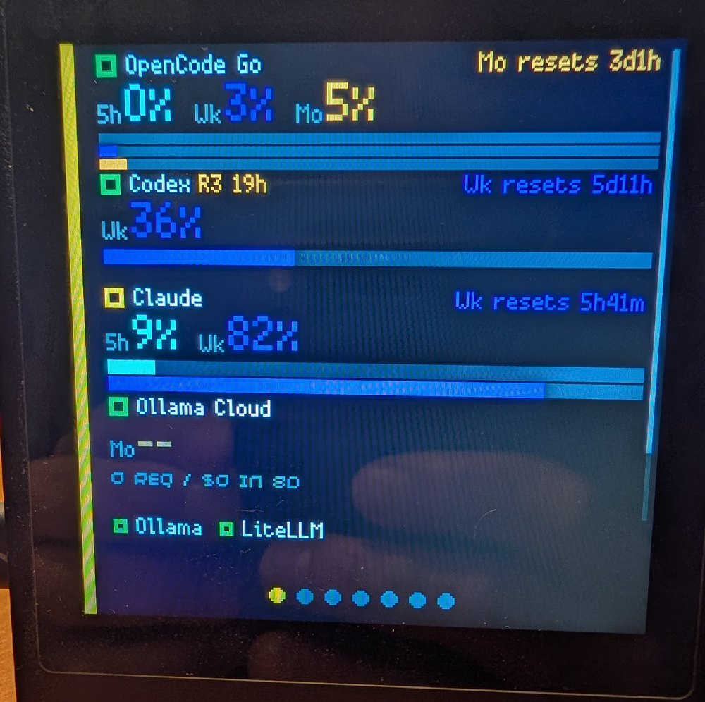
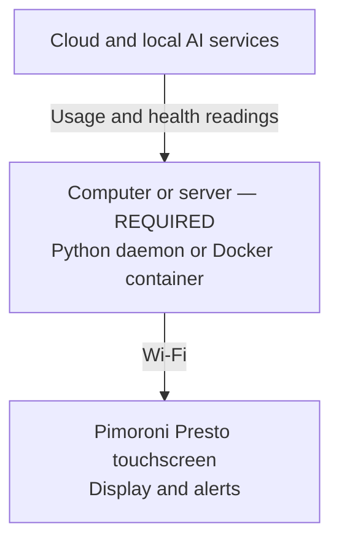

# Presto AI Dash

**Your AI coding limits, reset times, and local AI service health — right on your desk.**

[**Documentation**](https://jake1164.github.io/presto-ai-dash/) · [**Get Started**](https://jake1164.github.io/presto-ai-dash/getting-started/install-the-daemon/) · [**Request a Source**](https://github.com/jake1164/presto-ai-dash/issues/new/choose) · [**♥ Support**](#support-development)

  

## Your AI usage at a glance

Presto AI Dash turns a **Pimoroni Presto touchscreen** into a dedicated monitor for AI subscription quotas, reset countdowns, and local AI services. Swipe between service cards, see warnings at a glance, and know when a reading is stale or unavailable.

> [!IMPORTANT]
> **A separate computer or server is required.** This is **not a standalone app that runs entirely on the Presto**. You must run the **Python daemon as a background process or Docker container** on a computer/server on your network. It collects the data and keeps provider credentials; the Presto connects over Wi-Fi to display readings and control its own alerts.

## Supported services

- **Subscription quotas and resets:** [Claude Code](https://jake1164.github.io/presto-ai-dash/guides/claude/) · [OpenAI Codex](https://jake1164.github.io/presto-ai-dash/guides/codex/) · [OpenCode Go](https://jake1164.github.io/presto-ai-dash/guides/opencode-go/)
- **Cloud activity and local service health:** [Ollama Cloud](https://jake1164.github.io/presto-ai-dash/guides/ollama-cloud/) · [Ollama](https://jake1164.github.io/presto-ai-dash/guides/ollama/) · [LiteLLM](https://jake1164.github.io/presto-ai-dash/guides/litellm/)

Each link explains the metrics, collection method, setup, and limitations for that service. See also [Sources](https://jake1164.github.io/presto-ai-dash/concepts/sources/) and [where quota numbers come from](https://jake1164.github.io/presto-ai-dash/concepts/quotas-and-provenance/).

> [!TIP]
> **Missing your favorite AI service?** [Request a new source](https://github.com/jake1164/presto-ai-dash/issues/new/choose) — no coding or API knowledge required, and requests are free. Want to build one? [Contribute an integration](CONTRIBUTING.md) directly through a pull request.

## Get started

1. [Install the daemon](https://jake1164.github.io/presto-ai-dash/getting-started/install-the-daemon/) or [run it with Docker](https://jake1164.github.io/presto-ai-dash/getting-started/install-with-docker/) **on your computer or server**.
2. [Add your first source](https://jake1164.github.io/presto-ai-dash/getting-started/add-the-first-source/), or use simulated data to explore the dashboard.
3. [Set up the Presto](https://jake1164.github.io/presto-ai-dash/getting-started/set-up-the-presto/) to connect over Wi-Fi.

For configuration, troubleshooting, security, and detailed limitations, see the [documentation](https://jake1164.github.io/presto-ai-dash/) and [privacy notes](https://jake1164.github.io/presto-ai-dash/privacy/).

## Support development

If Presto AI Dash is useful, a **GitHub star** helps others discover it. Sponsorships and coffee donations help support maintenance, testing, and future integrations. Donations are optional and don't guarantee a particular integration.

  
  

## More projects

**Pimoroni and maker projects:** [Presto Snake](https://github.com/jake1164/presto-snake) · [Awesome Pimoroni Presto](https://github.com/jake1164/awesome-Pimoroni-Presto) · [Waveshare Weather Clock](https://github.com/jake1164/Pico-RGB-Matrix-Weather-Clock) · [Tempest Weather Clock](https://github.com/jake1164/tempest-led-weather-clock)

**Self-hosted software:** [Family Librarian](https://github.com/jake1164/family-librarian) · [M3Undle](https://github.com/Sydney-Elvis/M3Undle)

MIT licensed. See [LICENSE](LICENSE) and [third-party notices](THIRD_PARTY_NOTICES.md).
