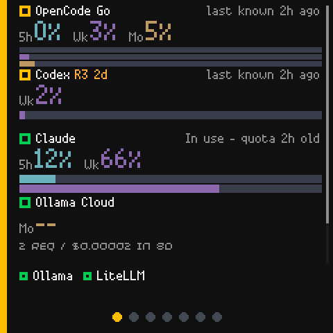
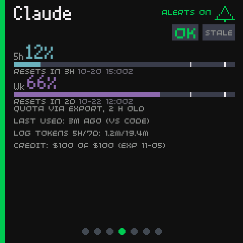

# What Presto AI Dash does

Presto AI Dash answers a handful of questions about your AI accounts without
opening a browser tab:

- Is anything close to a limit right now?
- When does the next window reset?
- Is my local model server up, and which model is loaded?
- How much have I used today, and how fast is it answering?
- Is anything broken, and if so, what exactly?

## The two halves

| Piece | Where it runs | What it does |
| --- | --- | --- |
| The daemon | A computer on your LAN (Windows, macOS or Linux) | Collects from the sources you configure, normalises the readings, keeps a short history, serves one JSON endpoint |
| The Presto app | On the Presto itself | Polls that endpoint, draws the Home list and one card per service, drives the LED and the sound |

The split exists for two reasons. The Presto has very little memory and no
way to hold a provider key safely, so it is given nothing but a display and a
single URL. The daemon has the network access, the storage and the
credentials, so it does the reading.

```text
  +--------------------+
  |   Pimoroni Presto  |   MicroPython app, 240x240 screen
  +--------------------+
        |  GET /api/v1/status  (bearer token)
        v
  +--------------------+
  |   Python daemon    |   your sources, your keys, your SQLite
  +--------------------+
        |  reads only
        v
   Claude, Codex, OpenCode Go, Ollama Cloud, Ollama, LiteLLM
```

## What you see on the device

**Home** is a list of your accounts in the order you saved them. Each row
carries a status marker, the account name, the key numbers and, for quota
accounts, one coloured bar per allowance window with the real period label
(`5h`, `Wk`, `Mo`). Accounts that do not fit on the screen move to a thin
strip at the bottom.



**One card per service**, reached by swiping left and right. A card shows the
biggest number, the window bars, the reset countdowns and a status chip.
Some cards have more detail behind a second tap.



**The LED** shows the worst service on the dashboard: red for critical, rate
limited or offline, yellow for a warning, blue for a service in use, green
for everything else. **The buzzer** chirps once when a service gets worse and
twice when it becomes critical, rate limited or offline.

## What it collects

| Kind | Example | How |
| --- | --- | --- |
| Quota windows | Claude 5h 12%, weekly 66% | A read-only HTTP call, a local file, or a report pushed from another machine |
| Activity totals | LiteLLM 12 requests today | A read-only HTTP call |
| Local health | Ollama reachable, llama3 loaded | A read-only HTTP call |
| Local use | Claude used 3 min ago | A local session log, read for timestamps and token counts only |
| Banked credits | 3 resets available | The provider's own allowance response |

Nothing is ever measured by asking a model to do work. The daemon never sends
a prompt, never starts a paid request, and never buys, spends or resets
anything.

## What it deliberately does not do

- **No analytics.** There is no telemetry, no counter and no crash reporting.
  The documentation site you are reading loads nothing from a third party
  either.
- **No cloud service.** There is no account to create and no vendor to sign
  up with.
- **No request history for services that do not keep one.** Ollama exposes
  no request log, so the dashboard reports reachability and the last
  *measured* speed, and says "unavailable" when nothing was measured. It
  never guesses.
- **No zero for an unknown.** A missing or expired reading shows `--` or a
  dimmed value, never `0%`.

## Where to go next

- [Install the daemon](install-the-daemon.md)
- [Set up the Presto](set-up-the-presto.md)
- [Add the first source](add-the-first-source.md)
- [Sources](../concepts/sources.md) and
  [quotas](../concepts/quotas-and-provenance.md), for the vocabulary.
