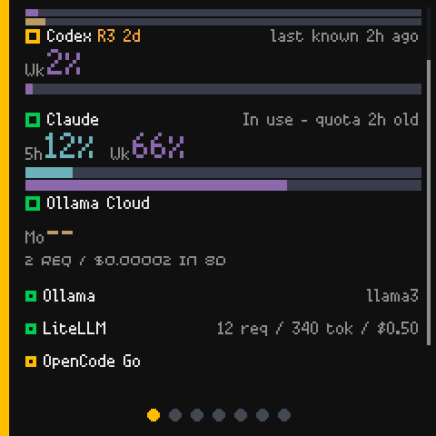

# Home display and the overflow strip

Home is the list you see first. It shows your accounts in the order you saved
them, and it never hides one of them behind a summary.

## The rows

Each account gets one row:

| Part | What it is |
| --- | --- |
| The marker | A small square in the account's status colour |
| The name | The display name you gave the account |
| The values | The key numbers: the window percentages, or the usage for a local service |
| The bars | One coloured bar per allowance window, with the real period label |

The colours identify the *period*, not the severity: a short window is one
colour, a weekly window another, a monthly window a third. The severity is
the marker and the status chip.

A window that has been measured fills its bar. A window with no reading is
empty. A window whose reset has passed shows `--` and an empty bar, never a
dimmed number and never `0%`.

A local service - Ollama or LiteLLM - gets a compact one-line row at its own
position: the marker, the name, and its usage or its loaded model. When every
account is a local service, the rows keep their two-line form.

## Scrolling

Drag up and down on the list to scroll it. The scrollbar on the right shows
the position. The list scrolls by its total height, so rows of different
heights are handled correctly.

The Home list remembers where you were when you come back from another card.

## The overflow strip

There is not enough room for every account on a 240x240 screen. The
accounts that do not fit are named in a thin strip at the bottom of the
screen, each with its status marker.

- The strip uses only as many lines as the hidden names need, up to the
  maximum you set.
- When the maximum is not enough, the strip shows `+N` instead, in the
  colour of the worst hidden status.
- As you scroll, rows move between the list and the strip.
- The strip disappears entirely when the whole list fits.

The number of lines is decided from the layout - the rows, the names and the
setting - and never from the scroll position, so the list does not jump while
you scroll. Each extra line costs 18 pixels of list height.

## The setting

The maximum number of lines the strip may use is in the admin page, under
**Settings -> Home display**. It is an integer from 0 to 3, and 1 is the
default. 0 turns the strip off entirely.

It is read afresh for every status payload, so a change applies on the next
poll without restarting the daemon. Three sources decide it, in this order:

1. the `DASH_OVERFLOW_ROWS` environment variable,
2. the value stored in the database by the admin page,
3. `[display] overflow_rows` in the configuration file,
4. one line, when nothing else says otherwise.

When the environment variable is set, the page's control is read-only.

## The dots at the bottom

The row of dots at the bottom of the screen shows which card you are on and
how many there are. The current one is filled and coloured. Tapping a dot
jumps straight to that card. See
[Tapping rows and dots](tapping.md).

## See also

- [Tapping rows and dots](tapping.md)
- [Alerts and the card bell](alerts-and-the-bell.md)
- [Sources](../concepts/sources.md)
